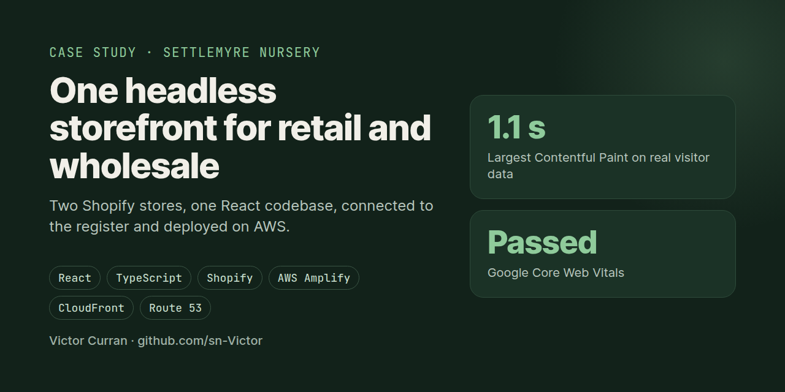
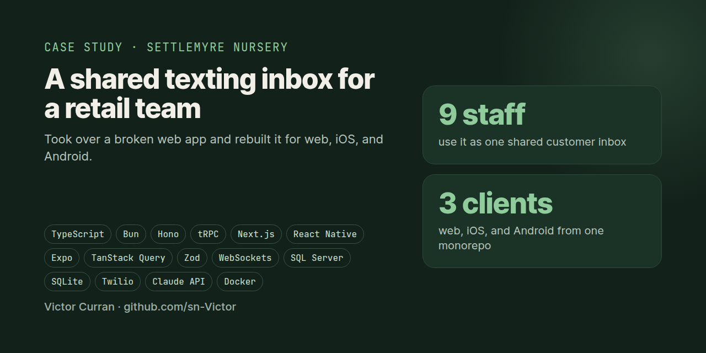
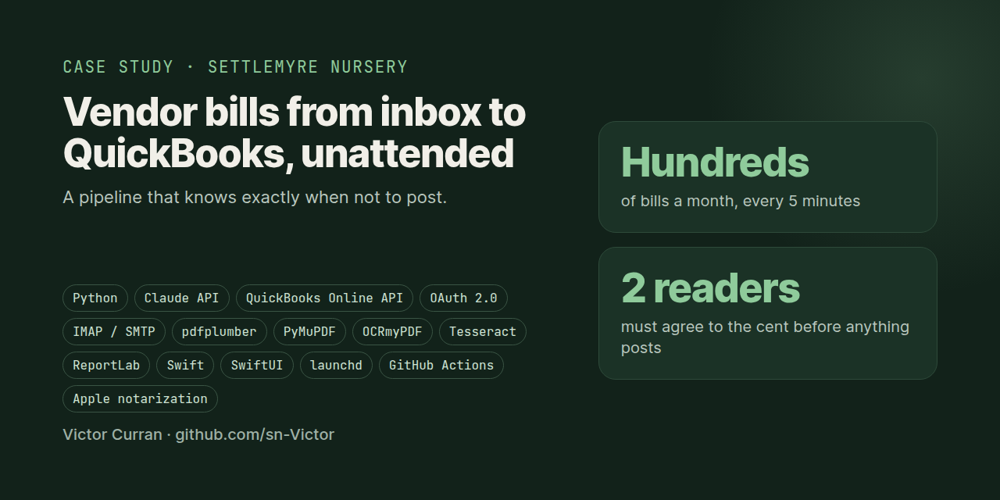

# Hi, I'm Victor 👋

Full-stack engineer who likes owning a product end to end: working out what people need, designing it, shipping it, and keeping it running in production.

- 🛠️ **Currently building:** a phone agent that runs open-source LLMs on my own GPUs
- 🎓 **Studying:** Computer Science at Appalachian State (Dec 2027), Data Science Certificate
- 💼 **Open to:** SWE internships and new opportunities

---

## 📂 Case studies

Production systems I've designed, built, and run. Each case study covers the problem, the key decisions, real bugs, and results.

<!--
  ADD A NEW CASE STUDY:
  1. Copy one <tr>...</tr> block below
  2. Change the repo link (2 places), image, title, description, and stack
  3. Put the 1280x640 image in this repo's images/ folder
  Newest or strongest work goes at the top.
-->

<table>
  <tr>
    <td width="45%" valign="top">
      
    </td>
    <td valign="top">
      <h3><a href="https://github.com/sn-Victor/headless-storefront-case-study">Headless Retail and Wholesale Storefront</a></h3>
      
Two Shopify stores served from one React codebase, with commercial account switching, merged online and in-store order history, and build-time prerendering for SEO. Passes Core Web Vitals on real visitor data.

      
<code>React</code> <code>TypeScript</code> <code>Shopify</code> <code>AWS</code>

    </td>
  </tr>
  <tr>
    <td width="45%" valign="top">
      
    </td>
    <td valign="top">
      <h3><a href="https://github.com/sn-Victor/team-messaging-platform-case-study">Team Messaging Platform</a></h3>
      
Took over a broken web app and rebuilt it for web, iOS, and Android. A shared customer texting inbox for a 9-person team, built so a text never fails when the database link drops.

      
<code>Next.js</code> <code>React Native</code> <code>Bun</code> <code>tRPC</code> <code>Twilio</code>

    </td>
  </tr>
  <tr>
    <td width="45%" valign="top">
      
    </td>
    <td valign="top">
      <h3><a href="https://github.com/sn-Victor/accounting-automation-case-study">Accounting Automation Pipeline</a></h3>
      
Hundreds of vendor bills a month from inbox to QuickBooks Online, unattended. Every bill is read twice and only posts when both reads agree to the cent, with a native Mac app for the bookkeeper.

      
<code>Python</code> <code>Claude API</code> <code>QuickBooks API</code> <code>SwiftUI</code>

    </td>
  </tr>
</table>

## 🧪 Projects

Side projects and experiments.

<!--
  ADD A NEW PROJECT: uncomment the line below, copy it for each project, and fill it in.
  Keep descriptions to one line. Move a project up to Case studies once it has a full write-up.

| [Project name](https://github.com/sn-Victor/repo-name) | One line on what it does and why it's interesting | `Tech` `Tech` |
-->

| Project | What it is | Stack |
|---------|------------|-------|
| Local AI phone agent *(in progress)* | Answers phone calls with an open-source LLM running on two local GPUs, tuned for low latency | `Twilio` `vLLM` `SGLang` `Qwen3` |

## 🧰 Stack

**Frontend:** React, TypeScript, Next.js, Tailwind CSS, React Native (Expo)

**Backend:** Node.js, Bun, Python, tRPC, Hono, REST APIs

**Data:** PostgreSQL, SQL Server, SQLite

**Cloud and tools:** AWS (Amplify, CloudFront, S3, Route 53), Docker, GitHub Actions

**AI:** Claude API, local LLM serving

## 📫 Contact

[LinkedIn](https://linkedin.com/in/victor-curran)
